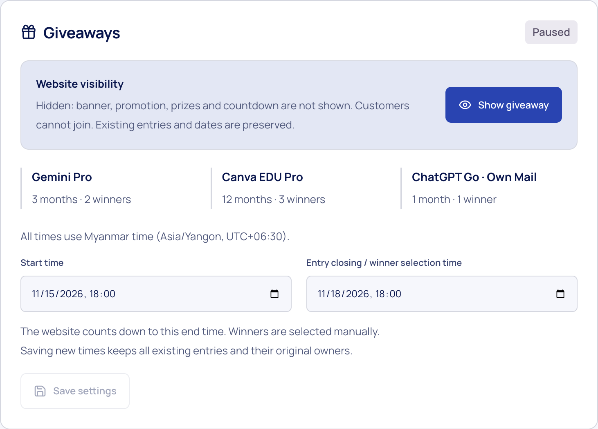

# Giveaway postponement — 16 November 2026

The owner postponed the giveaway because the website launch is pending. Runtime `8d1d847` is Completed/Current on both Hostinger environments.

Admin → Giveaways → Hide giveaway removes the public banner, promotion slide, prize section and countdown. Public GET returns JSON null, while hidden join requests are refused under the campaign row lock. Show giveaway restores visibility under the saved schedule. Visibility writes use the existing admin authentication, same-origin protection and revision checks. Schedule edits and existing entry ownership are retained.

Production was hidden through the authenticated admin API. Read-after-write checks verified Paused, visible false, both original participants unchanged, identical start/end/launch times and 51 published catalog products. Live browser inspection found zero giveaway surfaces. No live customer, order, catalog entry or participant was created/deleted for testing. Account connection copy no longer advertises the campaign.

## Verification

- Clean tracked-source snapshot, Node 24.22.3: strict lint, typecheck, production build and 103 unit tests passed.
- Disposable loopback giveaway integration passed: legacy table migration, date windows, authenticated hide/show, origin/revision rejection, hidden null responses, denied joins/retries, restored entry and immutable participant ownership.
- Local browser Hide action showed Paused and Show giveaway; the public fixture returned null. Test data stayed in its separate loopback database.
- Actual Hostinger staging and production deployment pages showed Completed/Current for the runtime commit.
- Production browser confirmed the hidden surfaces and the Paused admin control.

## Separate OTP banner

OTP Link uses a locally scheduled banner, so its independent `GIVEAWAY_ENABLED` switch was set false and release `9290c3f` was uploaded as `public_html/index.php`. Before replacement, the previous live worker hash matched the prior committed PHP source. After replacement, the live worker hash prefix is `ded8e84120c2`, matching the reviewed new file. No protected data or lock file was uploaded or edited, and no customer token was opened for analytics testing.

OTP validation passed PHP lint, 205 server checks and 18 customer-script checks. Fresh customer page loads omit the banner; already-open older pages need reloading.

## Reopening

Keep the campaign hidden until the owner requests reopening. Review the saved schedule before Show giveaway; entries still follow that schedule. Separately review the OTP banner dates/prizes and enable its switch when appropriate. No new campaign dates were assigned during postponement.
