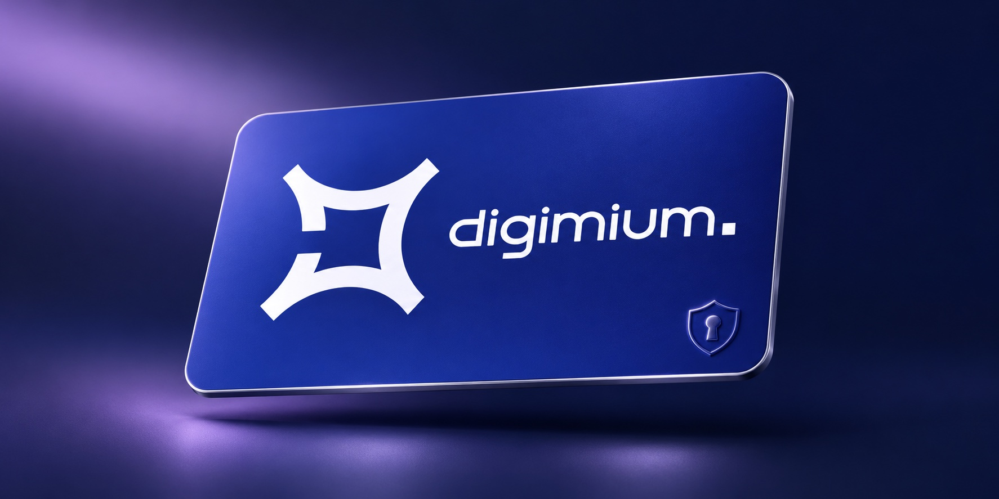
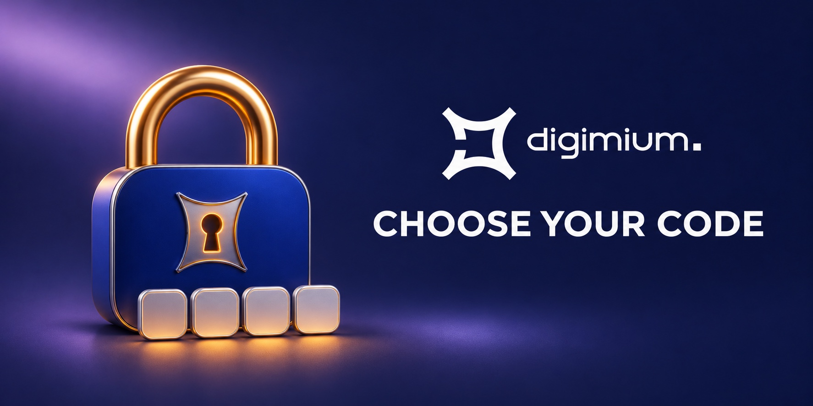
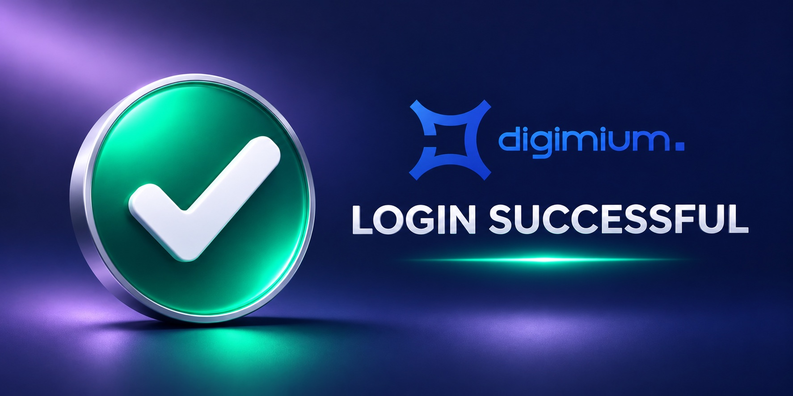

# Digimium Telegram welcome artwork

`login-welcome.jpg` is AI-generated with the built-in image generation tool on
15 November 2026, using the supplied `public/assets/logo.png` as the brand reference.
The selected image was converted to JPEG for Telegram photo delivery. The
wordmark and portal remain Digimium brand elements. This artwork conveys account
access; it contains no payment details or login codes.

## Generation prompt

Use case: stylized-concept. Asset type: Telegram bot welcome/login banner for Digimium digital subscription store. Create one polished wide landscape image about 2:1, premium minimalist 3D product photography. Reference image is the official Digimium logo: preserve its distinctive four-sided concave portal symbol and exact lowercase wordmark 'digimium.' and their proportions; this is supporting brand artwork, not an edit target. A single slim deep Persian-blue premium access card floats in subtle perspective over a midnight navy studio surface, soft lavender light and a refined thin silver edge. Place the supplied Digimium portal and wordmark cleanly on the face in white, large enough to read on a phone. A small elegant embossed keyhole or shield detail at the lower right suggests account access. One card only; no service-logo clutter, no gifts, no money/chip/payment-card numbers, no QR, no fake login code, no promotional claims, no other text. Card is the central subject with generous clean negative space, calm soft studio lighting, realistic depth, restrained reflections. Palette Persian blue #1f45b8, navy #051650, soft lavender, silver and white. Original logo geometry must remain faithful. No watermark.

## Verification stage

`login-verify.jpg` uses a closed blue/amber lock and blank code tiles to identify
the verification request. There is no fixed challenge code in the artwork.
Created with the built-in image generation tool on 15 November 2026, editing the
welcome artwork with the official logo as a second reference, then converted to JPEG.

Edit the supplied Digimium welcome artwork into a NEW matching Telegram LOGIN VERIFICATION stage banner. Preserve the original Digimium portal silhouette and lowercase 'digimium.' wordmark faithfully from the second reference. Keep premium minimalist realistic 3D studio rendering and a wide 2:1 composition. Replace the large access card with a clearly recognizable elegant CLOSED PADLOCK on the left, with a blue body and warm amber metallic shackle/accent. Beside its base are four small raised blank code tiles, no digits. On the right put the Digimium logo modestly above the clearly legible exact headline 'CHOOSE YOUR CODE'. Use the first reference's midnight navy/Persian-blue environment, a restrained warm amber light for the verification action, refined silver edges, soft shadows, calm spacious layout. The lock and four tiles must carry the visual message even on a small phone. No green checkmarks, no success claim, no real login code, no QR, no payment numbers, no other logos or text. This is a verification-request state, not yet signed in. Keep the design clean and substantially different in silhouette from the existing card.

## Completed session stage

`login-success.jpg` uses an emerald/white checkmark to distinguish actual website
login success. It is sent only after successful session issuance.
Created with the same built-in tool and references on 15 November 2026, then
converted to JPEG.

Edit the supplied Digimium welcome artwork into a NEW matching Telegram LOGIN SUCCESS stage banner. Preserve the official Digimium portal silhouette and lowercase 'digimium.' wordmark faithfully from the second reference. Keep premium minimalist realistic 3D studio rendering and wide 2:1 composition. Replace the large access card with one LARGE, unmistakable WHITE CHECKMARK in a polished emerald/teal circular badge on the left, standing at a slight perspective over the studio surface. On the right put the Digimium logo modestly above the clearly legible exact headline 'LOGIN SUCCESSFUL'. Midnight navy and Persian-blue brand foundation with a distinct emerald/teal glow and soft lavender accents, refined silver bevels, soft depth shadows. Bright, calm and reassuring; the checkmark must remain obvious at phone-chat size. The visual should match the verification banner family while being instantly distinguishable by both color and silhouette. No padlock, no code tiles, no digits, no QR, no payment numbers, no extra text or logos, no confetti clutter. This image represents a website session that has actually completed.
